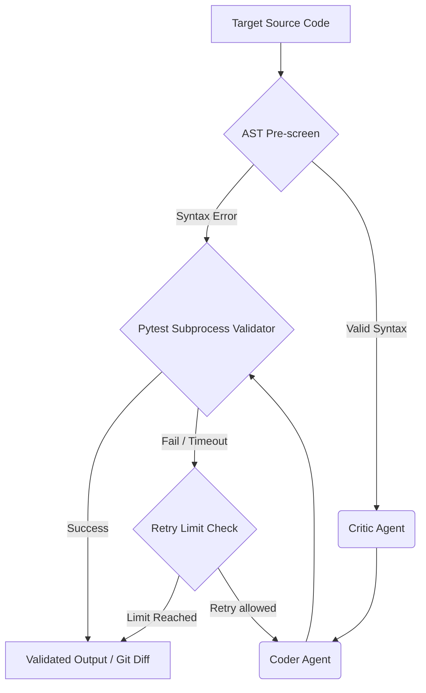

# CodeGuardian

CodeGuardian is a production-ready, stateful multi-agent code review and refactoring engine built in Python. It harnesses LangGraph for state management, Gemini via LangChain for intelligent code transformations, and an isolated `pytest` subprocess loop for deterministic validation and self-healing.

## Architecture

The workflow routes a target Python file through the following pipeline:



## Key Trade-offs & Engineering Decisions

1. **Deterministic AST Pre-screening**:
   - *Decision*: We invoke Python's built-in `ast.parse` immediately on the incoming code, catching `SyntaxError`s deterministically.
   - *Trade-off*: Adds minimal overhead but entirely prevents wasting tokens and LLM time trying to critique fundamentally unparseable code. It directly emits line offsets for syntax failures back into the agent pipeline.

2. **LangGraph State Machine**:
   - *Decision*: By standardizing the pipeline onto a `TypedDict` workflow state (`source_code`, `ast_context`, `test_output`, `review_feedback`), CodeGuardian ensures reliable agent handoffs.
   - *Trade-off*: Increased upfront boilerplate compared to chained prompt calls, but ensures scalability and strict cyclical routing logic (e.g., self-healing retries based on pytest failures).

3. **Self-Healing Pytest Validator**:
   - *Decision*: We run `pytest` via `subprocess` inside a `tempfile.TemporaryDirectory()`.
   - *Trade-off*: Running arbitrary LLM-generated code poses severe safety risks. While this system assumes a trusted underlying host or container environment (as it doesn't currently sandbox in a VM), the timeout and strict failure capturing act to prevent infinite loops or simple runaway scripts.

## Installation

```bash
pip install -r requirements.txt
export GOOGLE_API_KEY="your_gemini_api_key"
```

## Usage

```bash
python main.py --file target.py --test-file tests.py --report
```

Output includes live workflow streaming, a terminal unified diff, and an optional structured JSON report.
